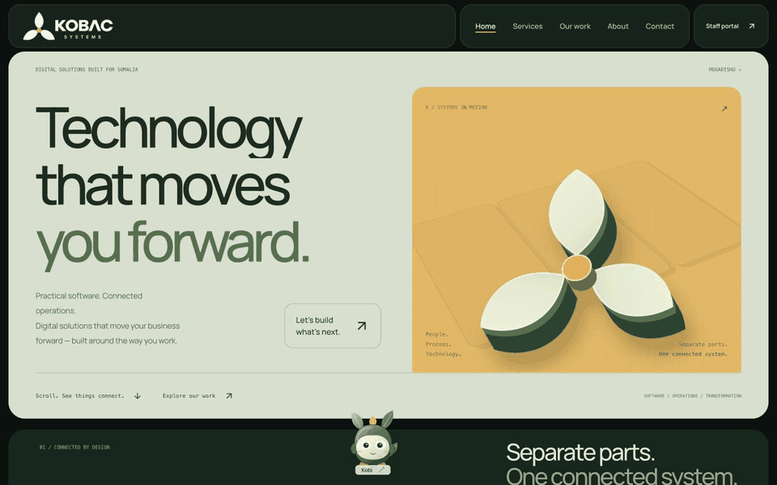
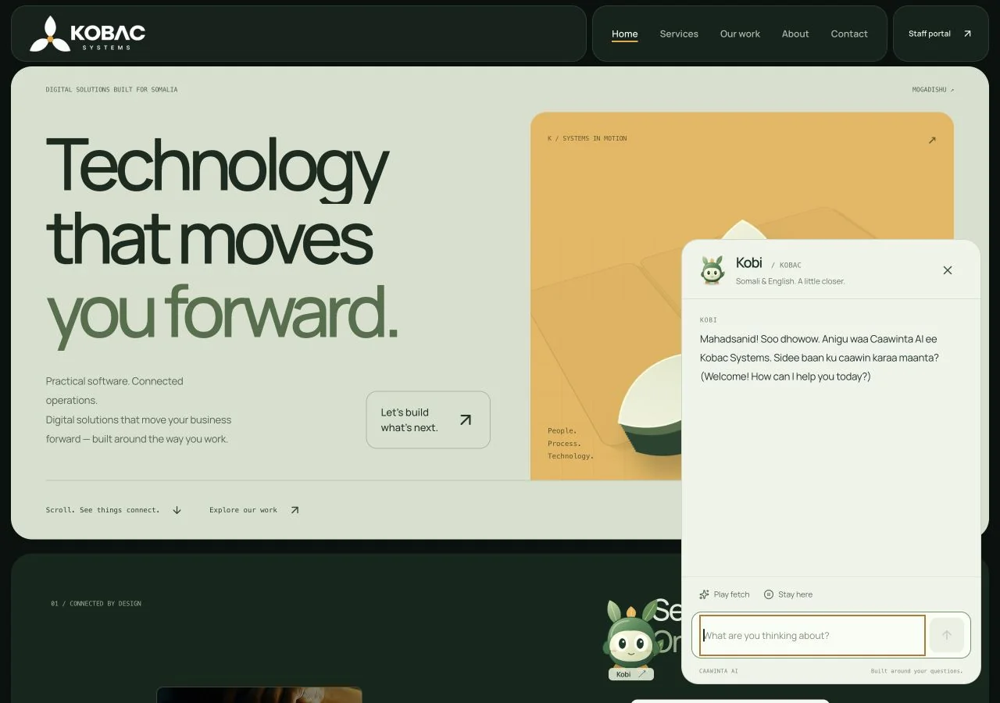
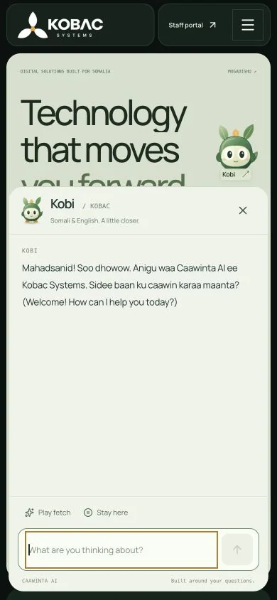

<div align="center">

<picture>
<source media="(prefers-color-scheme: dark)" srcset="public/kobac-logo.png" />

</picture>

# Technology that moves you forward.

**frontend design · v1.2**

Digital solutions. Connected operations. A little personality.

[](https://github.com/DDHDDHD3/kobac_systems/releases/tag/v1.2)


[Explore the website](https://kobacsystems.vercel.app/) · [What's new](CHANGELOG.md) · [Release & verification](docs/releases/v1.2.md) · [Contributing](CONTRIBUTING.md)

<a href="https://kobacsystems.vercel.app/"></a>

<sub>Captured from the local v1.2 frontend. Time-condensed scroll preview; <a href="docs/assets/frontend-hero.webp">static alternative</a>. GitHub's animated image does not inherit your device's reduced-motion setting.</sub>

</div>

## Built around the way you work

KOBAC Systems is an IT and digital transformation company in Mogadishu, Somalia. This repository contains its public website and staff Operations Portal, with an Express API and Neon PostgreSQL data layer.

**v1.2 is a frontend design release.** It updates the public experience while preserving the existing server, database schema, authentication, API contracts, staff workflows, inquiry forms, and AI integrations.

| Experience | What changed |
| --- | --- |
| Brand in motion | Forest green and amber from the actual logo, local variable Manrope, editorial typography, and a sculptural three-leaf hero. |
| Connected by design | Project posters travel from scattered positions into a measured grid, driven by native scroll progress and captured layouts. |
| Work, on a bigger stage | Full-width project scenes, image depth, direct demo/source links, and a filterable seven-project collection. |
| Meet Kobi | An original leaf-eared companion with tracking eyes, expressive poses, dragging, keyboard movement, roaming, and fetch play. Click Kobi to open the minimal AI chat. |
| A calmer option | A visible **Reduce motion** control and system preference support. Simplified layouts preserve content and actions. |

<details>
<summary><strong>Meet Kobi — desktop and mobile previews</strong></summary>

<p>


</p>

Drag Kobi, use the arrow keys while focused, or press Enter to chat. Escape closes the panel. Fetch invites play; reduced motion keeps the companion still. AI responses depend on the existing server configuration—there are no simulated answers.

</details>

## Project collection

These are collaborator-supplied repository projects, not invented KOBAC client engagements. Artwork and screenshots are labelled in the interface; [asset provenance](public/projects/SOURCES.md) records the sources.

| Project | Demo | Repository |
| --- | --- | --- |
| Uncanny Stranger | [Photography portfolio](https://uncannystranger.com/) | [Source](https://github.com/uncannystranger/uncannystranger) |
| Digital Invoice | [Frontend demo · sign-in](https://digital-invoice-inky.vercel.app/) | [Source](https://github.com/uncannystranger/digital_invoice) |
| Xaadir | [Attendance prototype · sign-in](https://xaadir.vercel.app/) | [Source](https://github.com/uncannystranger/xaadir) |
| Sahafi Rent Book | [Credit ledger](https://sahafi-restuarant.vercel.app/) | [Source](https://github.com/uncannystranger/sahafi-restuarant) |
| Diiwaan | [Queue management](https://diiwaan-so.vercel.app/) | [Source](https://github.com/uncannystranger/diiwaan.so) |
| Gurey Group | [Retail workspace · sign-in](https://gureygroup.vercel.app/) | [Source](https://github.com/uncannystranger/gureygroup) |
| Sentinel | [Cyber intelligence dashboard](https://uncannystranger.github.io/Cyber-Threat-Live-Dashboard/) | [Source](https://github.com/uncannystranger/Cyber-Threat-Live-Dashboard) |

Demo pages responded with HTTP 200 on 19 October 2026. This checks availability, not sign-in or transactions.

## Run locally

Use **Node.js 24** and **pnpm 9** (verified with Node 24.11.0 and pnpm 9.15.5).

```sh
pnpm install --frozen-lockfile
pnpm dev
```

Open **http://localhost:3000/**. Without a configured database, the public shell and motion can be previewed; database-backed requests return HTTP 503. Kobi shows an unavailable-service message instead of a fabricated response.

For full-stack development, copy `.env.example` to `.env` beside `server.ts` and use a **development** Neon database. The existing server initializes application tables at startup. On PowerShell: `Copy-Item .env.example .env`.

| Server variable | Purpose |
| --- | --- |
| `DATABASE_URL` | Neon PostgreSQL connection string beginning with `postgresql://`. Required for database-backed features. |
| `GEMINI_API_KEY` | Optional server-side Gemini key for AI chat and project scoping. |
| `KOBAC_CEO_PASSWORD`, `KOBAC_CDSO_PASSWORD`, `KOBAC_OPS_PASSWORD` | Optional values used by the existing staff-account provisioning workflow. |

Keep credentials out of source control and client-side `VITE_` variables. See `/api/health` for configuration status. Use development data for local testing.

```sh
pnpm lint       # TypeScript check (tsc --noEmit)
pnpm build      # Production frontend build
pnpm preview    # Static build preview; does not start the Express API
```

## Code map

```text
src/components/PublicWebsite.tsx     Public views, navigation and contact form
src/components/StudioExperience.tsx  Hero sculpture, connected gallery, work scenes
src/components/KobacCompanion.tsx     Character, play controls and chat presentation
src/components/TechnologyMotion.tsx  Shared motion controls and primitives
src/components/ProjectShowcase.tsx   Project collection and filters
src/data/projectCatalog.ts          Project descriptions and real demo URLs
src/studio.css · src/companion.css   Studio composition, character and chat
src/App.tsx                         Application state, staff portal, integrations
server.ts · api/ · src/db/           Existing API, serverless entry points, schema
public/fonts/ · public/licenses/    Local font files and third-party notices
```

The application retains its state-based public navigation. Motion uses the installed **Motion for React** library with lazy-loaded features, CSS transforms/keyframes, native scrolling, and cleaned-up observers/listeners. No additional animation engine, scroll hijacking, WebGL, or external pet service is required.

## Existing application features

Neon PostgreSQL remains the source of truth for CRM, projects, documents, contracts, reports, team profiles, company settings, inquiries, and published case studies. The Operations Portal uses authenticated APIs. Public bootstrap data includes published case studies, active team profiles, contact details, and branding. Staff manage publishing through **Public Website Content**; drafts are not returned by the public API. Saving dashboard changes refreshes dashboard and public data.

Signed-in staff can create, edit, and delete reports. PDF-ready print views and CSV downloads use available project, client, contract, and audit data. The AI Project Scoping Wizard stores inquiries and recommendations in **Communications & Inquiries**, where staff can review, assign, and convert accepted requests into client/project records.

The public AI assistant receives company settings and published case studies as context. Private dashboard records are not supplied to it. Missing or unavailable AI configuration returns an explicit service error.

## Deployment

The existing production address is **https://kobacsystems.vercel.app/**, connected to **`DDHDDHD3/kobac_systems`** in Vercel's **`abdallah-muses-projects`** scope. Deploy to that existing project; a separate project will not update its domain or inherit its integrations.

Keep the repository root as the project root. The existing `vercel.json` builds Vite into `dist` and configures API functions. In Vercel project settings, add `GEMINI_API_KEY` as a server-side environment variable for every environment where AI should work (Production and Preview as applicable); do not name it `VITE_GEMINI_API_KEY`. Save the setting and redeploy so the function receives it. Production and Preview also need their existing server-side `DATABASE_URL`. Check `/api/health` on the deployment: `aiConfigured` should be `true` without exposing the key.

Release title: **frontend design v1.2**. Git tag: **`v1.2`**. Package version: **`1.2.0`**. A GitHub push is not proof of deployment: verify Vercel status, the deployed commit, and the production page. [Release notes](docs/releases/v1.2.md) record validation and limits.

## Design & source credits

- KOBAC's existing logo informed the forest/amber palette and three-leaf shape language.
- [Fiddle Digital](https://fiddle.digital/) informed composition and motion research. Its proprietary artwork and source code were not copied.
- The captured-layout scroll technique adapts [Codrops' ScrollBasedLayoutAnimations](https://github.com/codrops/ScrollBasedLayoutAnimations) under MIT. The [complete notice](public/licenses/codrops-scroll-layout.txt) is included.
- Manrope is distributed locally under its [SIL Open Font License](public/fonts/Manrope-OFL.txt).
- Project assets retain their original ownership; consult [their sources](public/projects/SOURCES.md) before reuse. Third-party notices do not license the whole repository.

See [CONTRIBUTING.md](CONTRIBUTING.md) for the review checklist and release conventions.

## [Contributors](https://github.com/DDHDDHD3/kobac_systems/graphs/contributors)

Collaborating developer: [uncannystranger (Abdullahi Mohamud)](https://github.com/uncannystranger).

GitHub populates the contributor graph automatically from commits attributed to each developer's account. To appear there, commits must use an email address verified on that GitHub account and be pushed to the repository's default branch, typically by merging a pull request.
