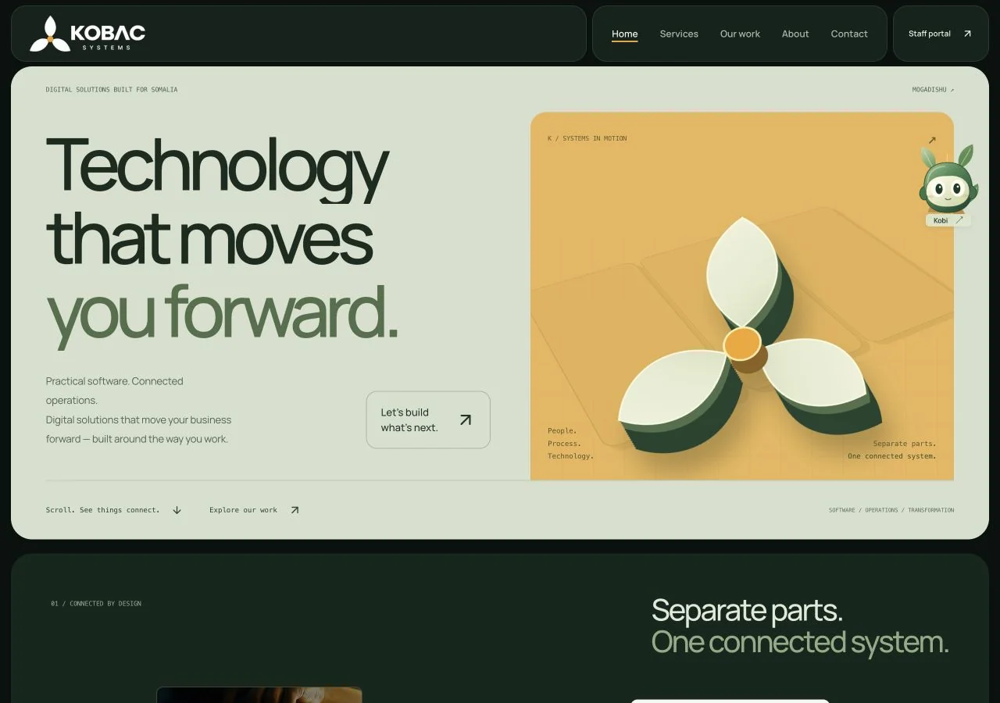

# frontend design v1.2

**Date:** 19 October 2026
**Git tag:** `v1.2`
**Package version:** `1.2.0`
**Scope:** public frontend and repository documentation

## Release intent

Publish the approved KOBAC design as one identifiable release: all approved presentation work, the studio motion direction, real project demos, and Kobi. Existing backend services and integrations are preserved.

## Experience

- Logo-led forest/amber identity, local variable typography, editorial hierarchy, floating split navigation, and a sculptural three-leaf hero.
- Native-scroll composition assembling project posters into a grid. Featured work uses full-width scenes, image depth, and demo/source actions.
- Process chapters, heading reveals, refined buttons, section rhythm, and a typographic footer.
- Original Kobi with expressive poses, dragging, keyboard movement, eye tracking, roaming, and fetch play. Minimal chat uses the existing `/api/ai/chat` integration.
- Mobile-specific composition and reduced-motion layouts. No scroll interception or new animation dependency.

## Main files

| Area | Files |
| --- | --- |
| Public views and integration | `src/components/PublicWebsite.tsx`, `src/App.tsx` |
| Motion and work | `src/components/StudioExperience.tsx`, `TechnologyMotion.tsx`, `ProjectShowcase.tsx`, `motion-features.ts` |
| Companion | `src/components/KobacCompanion.tsx`, `src/companion.css` |
| Design system | `src/index.css`, `studio.css`, `technology.css`, `project-motion.css`, `cinematic-motion.css`, `src/main.tsx` |
| Content and assets | `src/data/projectCatalog.ts`, `public/projects/`, `public/licenses/`, `public/fonts/` |
| Version and repository | `index.html`, `package.json`, `README.md`, `CHANGELOG.md`, `CONTRIBUTING.md`, `docs/` |

## Local verification

Reviewed in the in-app browser at **1280×900, 1280×720, 900×720, 768×1024, 390×844, and 320×740**. Additional README captures use 1280×800. Checked:

- No document-width overflow at reviewed sizes; project actions and mobile chat within the viewport.
- Native-scroll gallery transforms, project stages, desktop/mobile navigation, contact fields, and the CTA opening the existing scoping wizard.
- Seven project entries, category filtering, demo/source URLs, and external-link attributes.
- Kobi drag versus click, 24px keyboard movement, fetch movement, chat open/close and Escape, menu visibility, and resize bounds.
- Manual reduced motion stops character/sculpture animation, simplifies sticky layouts, and preserves controls. System preference support was inspected in hook/CSS; OS emulation was not separately tested.
- A local chat request reached the existing API and returned its database-not-configured error; the panel displayed the friendly service-unavailable state.

`pnpm lint` (`tsc --noEmit`), `pnpm build`, and `git diff --check` passed. There is no automated application test suite. The existing Vite `__dirname` configuration warning remains; it did not fail the build.

## Preserved boundaries

`server.ts`, `api/`, `src/db/`, authentication, schema, environment files, `vercel.json`, `vite.config.ts`, and dependency versions are unchanged. Package name/version and an HTML version marker identify the release. No credentials, build output, local logs, or database contents are included.

The contact-submit implementation and AI send handler were compared with the prior local revision and preserved. Published database case studies remain separate from the curated repository-project collection.

## Limits

The local frontend ran without `DATABASE_URL`. Successful AI replies, contact delivery, staff sign-in, portal writes, and other authenticated/database-backed transactions were not verified. No production records were created for testing. Cross-browser/physical-device testing, a formal accessibility audit, and measured frame-rate profiling were not performed.

The README GIF is a time-condensed sequence captured from the local site, not a real-time performance recording. A static alternative is linked beside it.

## Production deployment

The existing GitHub/Vercel connection targets `kobacsystems.vercel.app` under `abdallah-muses-projects/kobac_systems`. Publication must use that existing project. GitHub release status and Vercel deployment status are separate gates; release publication records their actual outcome.

## Credits

The layout-capture technique adapts Codrops' MIT-licensed [ScrollBasedLayoutAnimations](https://github.com/codrops/ScrollBasedLayoutAnimations); the full notice is in `public/licenses/`. Fiddle Digital supplied visual research direction; its proprietary assets/source were not copied. Font and project-asset notices are linked in the README.
